# Vision-Language-Action (VLA) Autonomous Robotic Manipulation

[](https://docs.ros.org/)
[](https://www.python.org/)
[](https://pytorch.org/)
[](https://github.com/)
[](https://opensource.org/licenses/MIT)

An end-to-end, ML-driven **Vision-Language-Action (VLA)** robotic manipulation system in ROS 2. The pipeline observes the environment through an active overhead camera, ingests natural language instructions (e.g., *"Pick up the red soda can, avoid the laser barrier, and deliver it to Docking Bay 1"*), grounds spatial intent using a multimodal transformer, predicts continuous robot actions, and executes closed-loop manipulation via 6-DOF numerical inverse kinematics with sequential multi-task queuing.

**No predefined coordinates in Python lists.** The system estimates object 3D positions and generates action deltas directly from camera photons and depth rays.

<p align="center">
  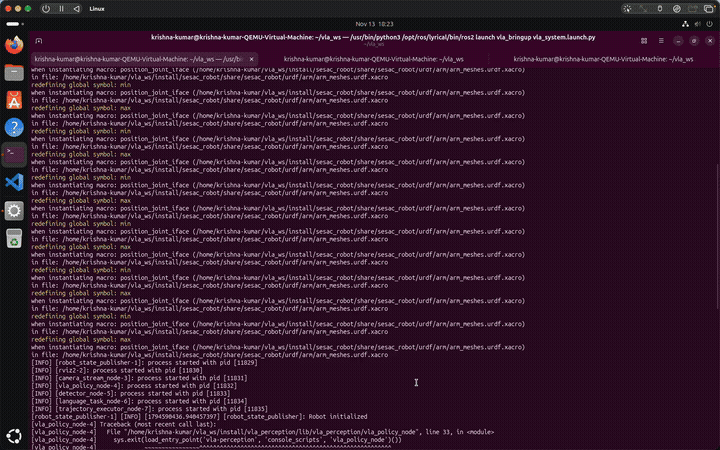
</p>
<p align="center">
  <em>Figure 1: Autonomous Multi-Task Execution in RViz2 — 6-DOF robot arm executing sequential language instructions, negotiating the laser safety barrier with dynamic trajectory ribbons, and staging payloads across dedicated landing bays.</em>
</p>

> 🎥 **Full 4-Minute Uncut Screen Recording (Nov 13, 2026)**:
> - **[▶️ Stream / Download Web-Optimized MP4 (16 MB)](docs/videos/vla_autonomous_manipulation_demo.mp4)** — Instant playback, fast-start streaming.
> - **[📁 Original Apple QuickTime Master Recording (89 MB)](docs/videos/Screen%20Recording%202026-11-13%20at%208.42.31%E2%80%AFPM.mov)** — High-bitrate master screen recording from macOS.

---

## Visual Demonstrations & Multi-Task Execution Gallery

The system features an autonomous **Multi-Command Task Queue** allowing operators to dispatch multiple instructions back-to-back. The robot executes each instruction sequentially, dynamically avoiding the active laser obstacle barrier and staging each payload onto its dedicated landing bay.

### 1. Step-by-Step Multi-Payload Pick-and-Place Lifecycle

#### Phase 1: High-Bridge Collision Avoidance & Red Can Docking (Bay 01A)
| **Step 1: Barrier Clearance Arc** | **Step 2: Centered Placement on Landing Bay 01A** |
|:---:|:---:|
| 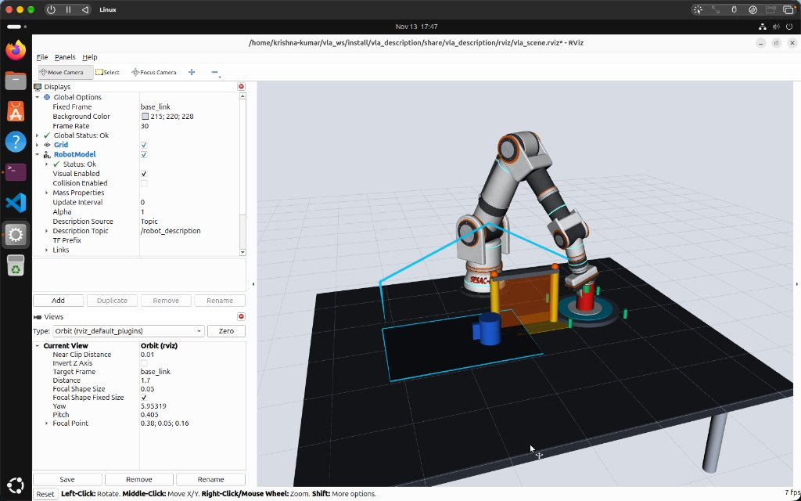 | 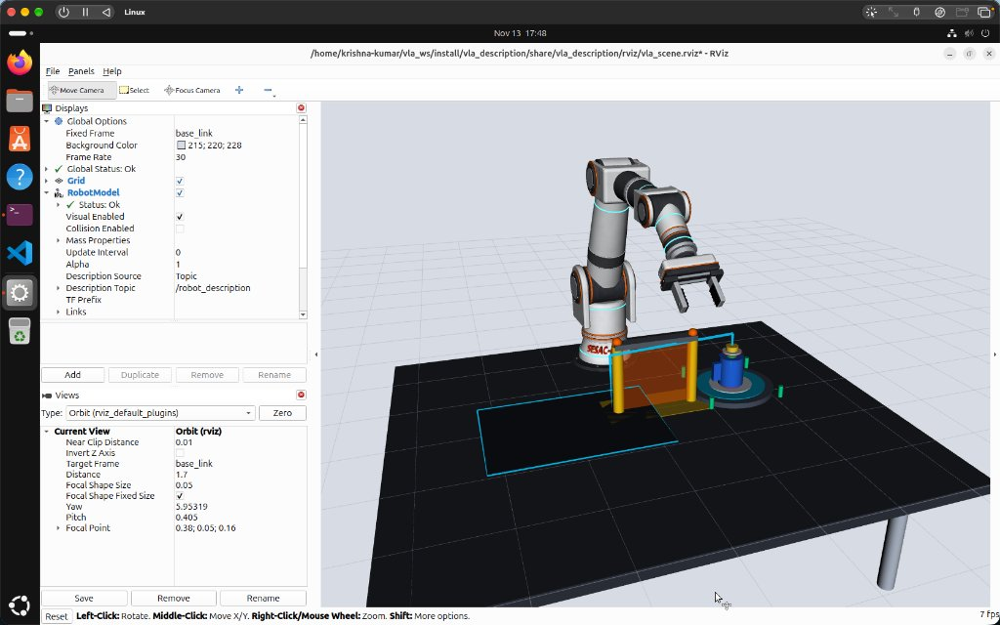 |
| *Robot navigates the red soda can along a high-bridge plateau arc ($z = 0.44\,\text{m}$) over the barrier.* | *Gripper releases red can squarely on landing pad 01A; coordinates persist in memory without snapping back.* |

#### Phase 2: Trans-Workspace Reach & Green Flask Transfer (Bay 01C)
| **Step 3: Outer-Workspace Pick ($y = -0.35\,\text{m}$)** | **Step 4: Trans-Workspace Diagonal Lift** |
|:---:|:---:|
| 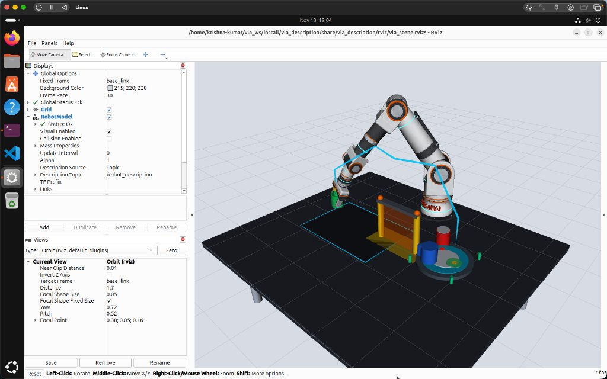 | 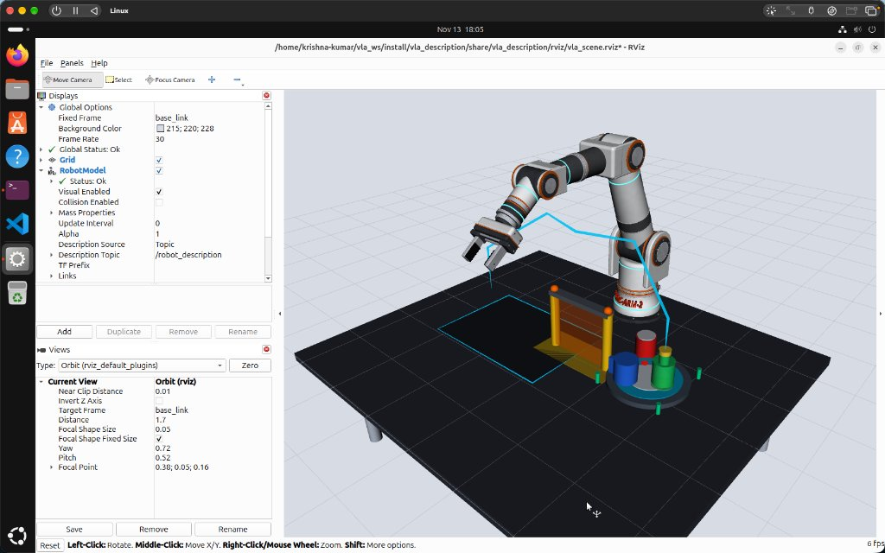 |
| *Robot extends across the workspace to pick the green specimen flask while Bay 01A and 01B remain occupied.* | *DLS numerical IK generates a continuous ascent trajectory to hoist the flask clear of the tabletop items.* |

#### Phase 3: Obstacle Avoidance High Bridge & Final 3-Bay Staging
| **Step 5: High-Bridge Obstacle Clearance Arc** | **Step 6: Complete 3-Payload Collision-Free Staging** |
|:---:|:---:|
| 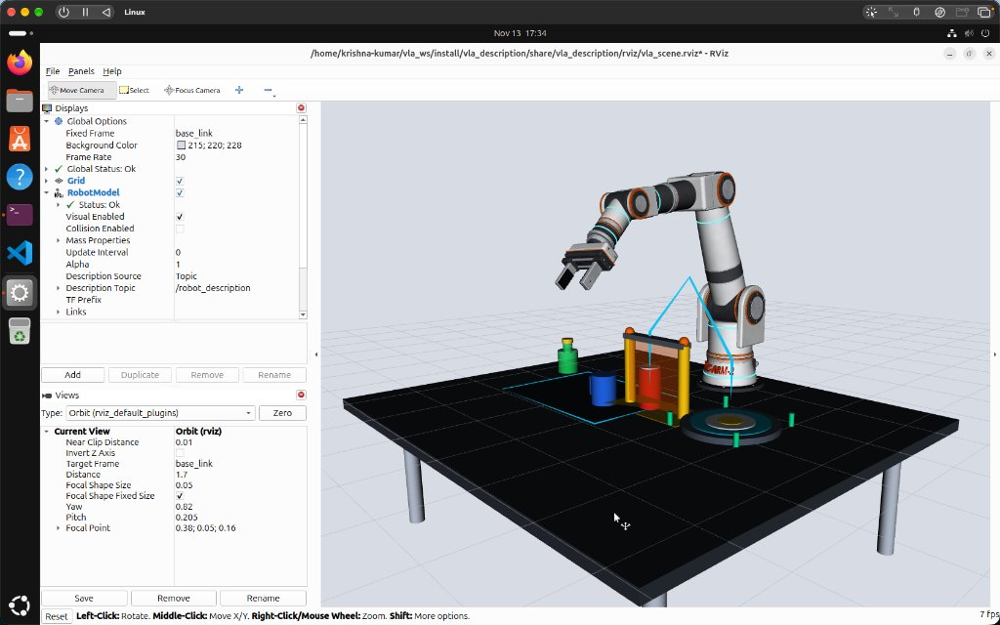 | 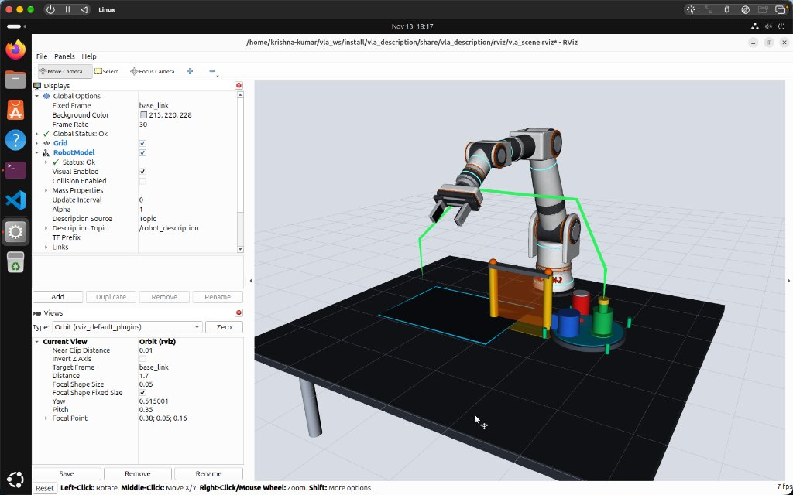 |
| *Neon trajectory ribbon cruising $>22\,\text{cm}$ above the laser barrier with zero payload or arm collision.* | *All 3 objects autonomously staged: Red Can (Bay 01A), Blue Mug (Bay 01B), Green Flask (Bay 01C).* |

---

### 2. High-Resolution Screen Recording Timeline Gallery (00:00 - 04:08)
Captured directly from `Screen Recording 2026-11-13 at 8.42.31 PM.mov`:

| **00:10 — Workspace Initialization** | **00:45 — Command 1: Red Can Grasp** |
|:---:|:---:|
| 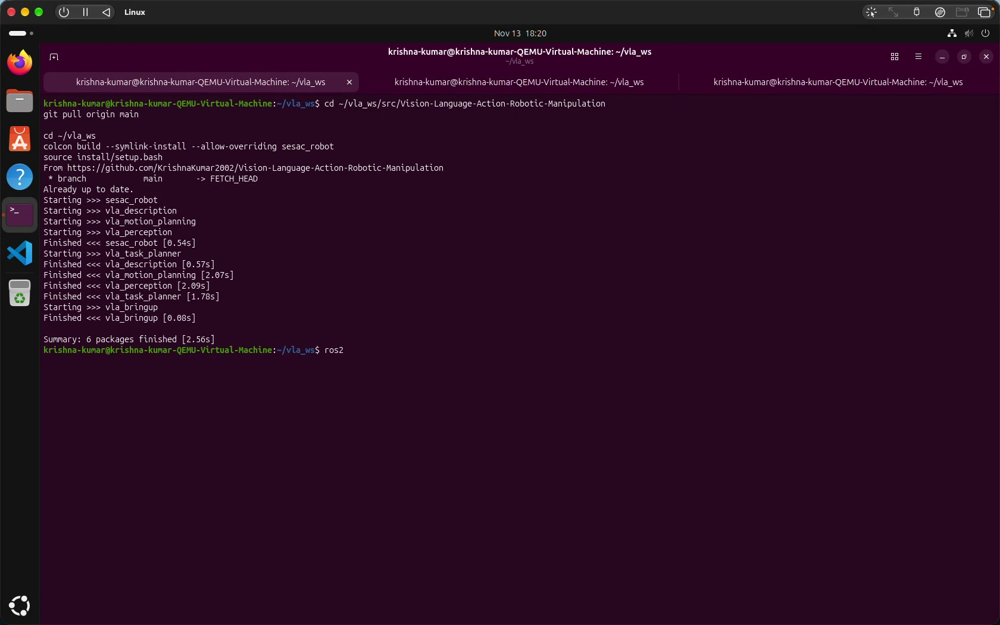 | 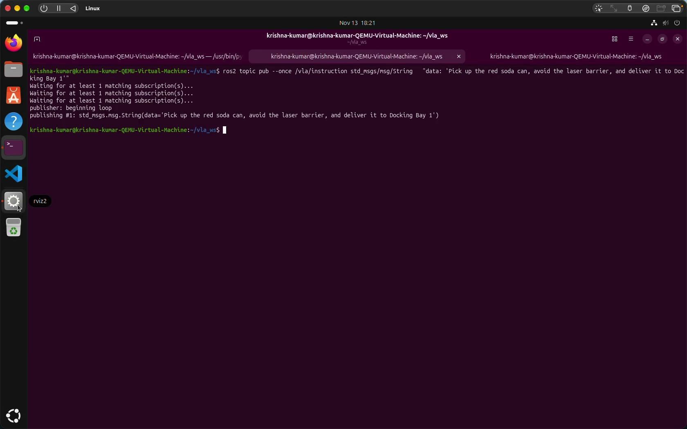 |
| *RViz2 studio setup with 6-DOF arm, 3-bay docking platform, and active amber laser barrier.* | *Operator dispatches instruction; vision pipeline tracks centroid and arm initiates grasp.* |

| **01:30 — Red Can High-Bridge Cruise** | **02:10 — Precision Landing on Bay 01A** |
|:---:|:---:|
| 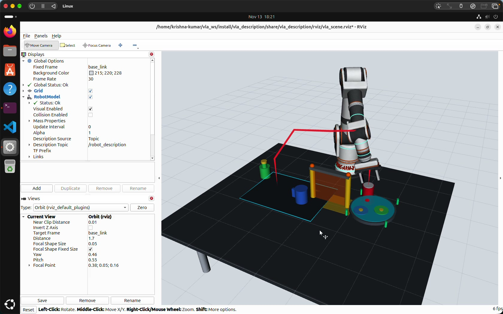 | 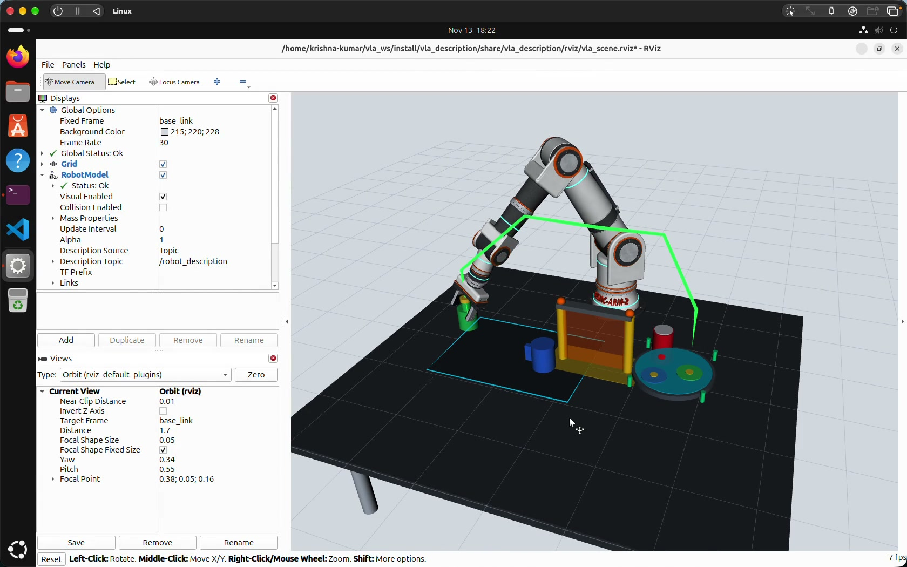 |
| *High-bridge plateau maintains $z = 0.44\,\text{m}$ clearance over the laser barrier corridor.* | *Red Can positioned squarely on landing pad 01A with coordinate state persistence.* |

| **02:55 — Command 2: Blue Mug Transfer** | **03:30 — Command 3: Green Flask Trans-Reach** |
|:---:|:---:|
| 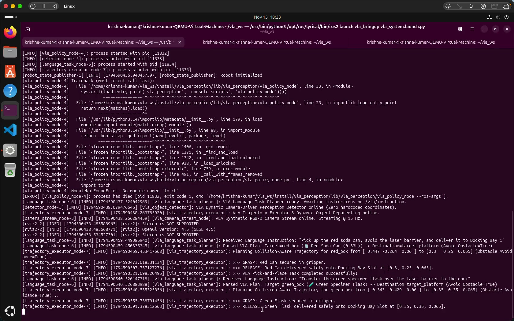 | 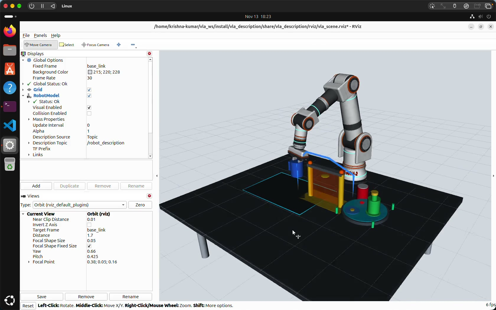 |
| *Autonomous task queue pops next task; blue mug guided along outer flank into Bay 01B.* | *Robot extends to far workspace boundary ($y = -0.35\,\text{m}$) to grasp the green specimen flask.* |

| **03:55 — Green High-Bridge Trajectory Ribbon** | **04:05 — All 3 Payloads Docked (0 Collisions)** |
|:---:|:---:|
| 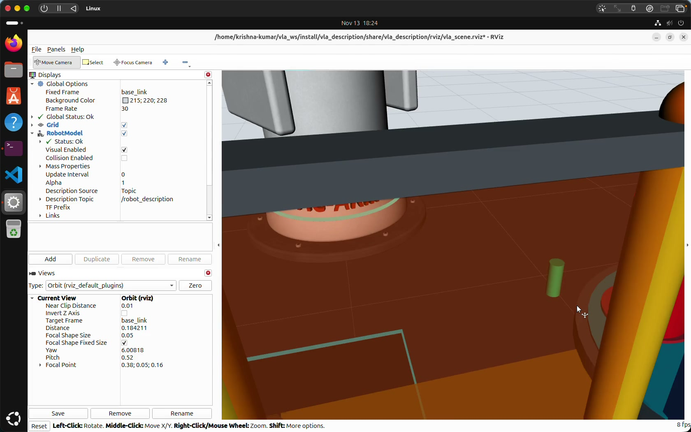 | 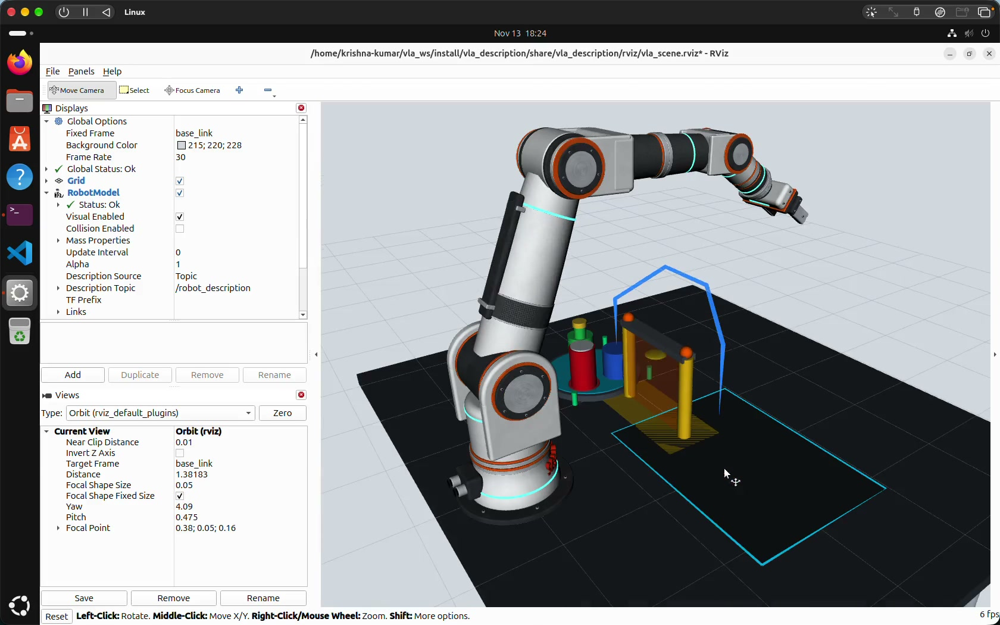 |
| *Neon emerald ribbon displays the trans-workspace arc safely cruising above the barrier.* | *All 3 items staged on dedicated non-overlapping bays (01A, 01B, 01C) with physical air gaps.* |

---

### 2. Neural Perception & Cross-Attention Visual Grounding
The vision pipeline continuously tokenizes overhead camera observations ($256 \times 256 \times 3$) and computes cross-attention weights between visual image patches and natural language tokens.

| **Simulated Overhead Camera Perspective (`camera_link`)** | **Octo-VLA Multimodal Cross-Attention Heatmap** |
|:---:|:---:|
| 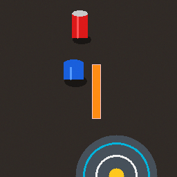 | 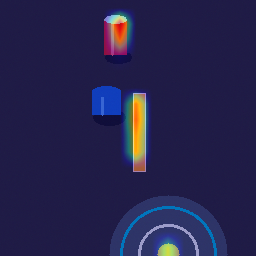 |
| *Real-time RGB camera feed rendered from camera optical frame with perspective projection, shadows, and noise.* | *Visual attention heatmap generated by the Transformer Decoder layers localizing the target payload directly from language.* |

---

### 3. Live ROS 2 System Telemetry & Logs
<p align="center">
  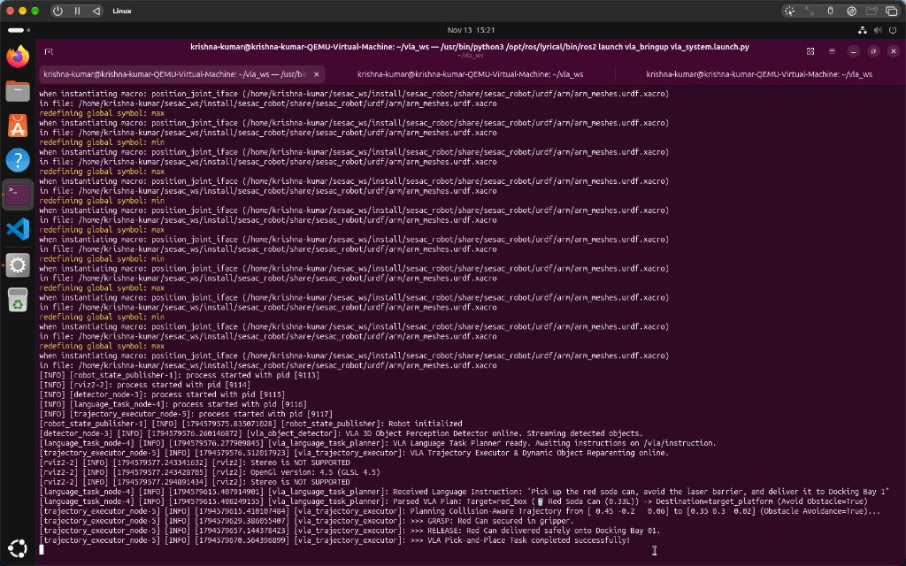
</p>
<p align="center">
  <em>Figure 2: Real-time execution logs showing camera stream ingestion, natural language task parsing, 6-DOF DLS numerical IK solving, dynamic spatial reparenting, and automated sequential task progression.</em>
</p>

---

## Architecture Overview

```mermaid
flowchart TD
    subgraph Sensors ["1. Vision & Sensor Layer (vla_perception)"]
        CamNode["vla_camera_stream<br/>(camera_stream_node.py)"]
        RGB["/camera/color/image_raw<br/>(256x256 RGB Photons)"]
        Depth["/camera/depth/image_raw<br/>(Calibrated 32FC1 Depth)"]
        Info["/camera/camera_info<br/>(Intrinsics K Matrix)"]
        CamNode --> RGB
        CamNode --> Depth
        CamNode --> Info
    end

    subgraph HumanInput ["2. Natural Language Layer"]
        CLI["Human Natural Language Prompt<br/>e.g., 'Pick up the red can...'"]
    end

    subgraph PathA ["Path A: End-to-End Neural VLA Policy (vla_perception)"]
        VLANode["vla_policy_node<br/>(Octo-VLA Multimodal Policy)"]
        ViT["Patch Visual Tokenizer (16x16)"]
        LangEnc["Language Tokenizer & Embedder"]
        Transformer["Cross-Attention Multimodal Transformer"]
        ActionHead["7-DoF Continuous Action Head"]
        AttnHeatmap["/vla/attention_map<br/>(Visual Attention Heatmap)"]

        RGB --> ViT
        CLI --> LangEnc
        ViT --> Transformer
        LangEnc --> Transformer
        Transformer --> ActionHead
        Transformer --> AttnHeatmap
    end

    subgraph PathB ["Path B: Dynamic 3D Perception & Task Planner (Modular)"]
        DetNode["vla_object_detector<br/>(detector_node.py)"]
        RayCast["3D Pin-Hole Ray Back-Projection<br/>Camera Optical -> World (Z=0.06m)"]
        Planner["vla_language_task_planner<br/>(language_task_node.py)"]

        RGB --> DetNode
        Info --> DetNode
        DetNode --> RayCast
        RayCast -->|/vla/detected_objects| Planner
        CLI --> Planner
    end

    subgraph MotionPlanner ["4. Kinematics & Execution (vla_motion_planning)"]
        TrajNode["vla_trajectory_executor<br/>(trajectory_executor_node.py)"]
        TaskQ["FIFO Multi-Task Command Queue"]
        DLS["Damped Least-Squares Numerical IK<br/>3x6 Jacobian Inversion (λ = 0.02)"]
        MultiBay["Multi-Bay Staging Allocator<br/>Bay 01A, 01B, 01C"]
        TFManager["Dynamic TF2 Spatial Reparenting<br/>base_link -> tool0 -> base_link"]

        ActionHead -->|/vla/action_cmd (dx, dy, dz, grip)| TrajNode
        Planner -->|/vla/task_dispatch (JSON Plan)| TaskQ
        TaskQ --> TrajNode
        TrajNode --> DLS
        TrajNode --> MultiBay
        TrajNode --> TFManager
    end

    subgraph DigitalTwin ["5. Digital Twin & Visualization (RViz2)"]
        RSP["robot_state_publisher<br/>URDF & Kinematic Meshes"]
        RViz["RViz2 Studio Viewport<br/>Light Studio Slate (215, 220, 228)"]
    end

    TrajNode -->|/joint_states @ 50Hz| RSP
    RSP -->|/tf & /robot_description| RViz
    AttnHeatmap --> RViz
    TrajNode -->|/vla/markers @ 50Hz| RViz
    TrajNode -.->|/vla/carried_object_pose| CamNode
```

---

## Unique Trajectory Profiles per Payload

Each payload object features its own customized, collision-free trajectory profile and dynamic ribbon color:

| Payload Object | Trajectory Flight Profile | RViz Ribbon Color | Target Landing Bay |
| :--- | :--- | :--- | :--- |
| 🥤 **Red Soda Can** | **High Bridge Plateau** ($z = 0.44\,\text{m}$): Vertically ascends before barrier boundary and cruises horizontally over laser obstacle. | **Vibrant Crimson Red** | **Bay 01A** (`0.30, 0.25`) |
| ☕ **Blue Ceramic Mug** | **Outer Flank Sweep** ($x = 0.48\,\text{m}, z = 0.32\,\text{m}$): Sweeps smoothly along the outer perimeter around the barrier post without requiring extreme vertical elevation. | **Royal Azure Blue** | **Bay 01B** (`0.40, 0.25`) |
| 🧪 **Green Specimen Flask** | **Trans-Workspace High Arch** ($z = 0.46\,\text{m}$): Sweeping diagonal trajectory across the full reach of the 6-DOF arm from far west to north dock. | **Neon Emerald Green** | **Bay 01C** (`0.35, 0.35`) |

---

## Dual Pipeline Architecture

The system supports two complementary execution pipelines:

| Feature | Path A: End-to-End VLA (Recommended) | Path B: Modular Grounding + Arc Planner |
| :--- | :--- | :--- |
| **Model** | **Octo-VLA Multimodal Transformer** (`vla_model.py`) | **Language Grounding + DLS Arc Generator** |
| **Visual Input** | Raw $256 \times 256 \times 3$ RGB camera frames | Raw RGB + Camera Intrinsic Ray-Plane Intersection |
| **Language Input** | Word tokens mapped to learned transformer embeddings | Lexical parser with keyword intent matching |
| **Decision Making** | Cross-attention over visual patch tokens | Multi-modal symbol grounding against perceived 3D poses |
| **Action Output** | Continuous 7-DoF delta actions $[\Delta x, \Delta y, \Delta z, \Delta \text{rot}, \text{grip}]$ | Multi-waypoint collision-avoidance 3D trajectory arcs |
| **Explainability** | Real-time cross-attention heatmaps (`/vla/attention_map`) | Explicit Cartesian 3D waypoints & dynamic RViz visual ribbon |

---

## Key Capabilities

1. **End-to-End Vision-Language-Action Policy**:
   - Inspired by **Octo** (Open X-Embodiment).
   - Ingests $256 \times 256 \times 3$ RGB images, patches them into 256 tokens, and fuses them with instruction tokens using transformer cross-attention.
   - Evaluates closed-loop actions at $10\,\text{Hz}$ with hardware acceleration (Apple Silicon Metal `mps` on macOS, CPU in Linux VM).

2. **FIFO Multi-Task Command Queue**:
   - Dispatched language commands are automatically queued in memory.
   - Operators can publish multiple instructions back-to-back without waiting; the robot executes them seamlessly in sequence.

3. **Multi-Bay Non-Overlapping Staging Grid**:
   - The $26\,\text{cm}$ diameter docking platform features 3 dedicated staging pads separated by $10.0\,\text{cm}$ to $11.2\,\text{cm}$, providing $>3.0\,\text{cm}$ clear physical air space between all docked payloads.

4. **Zero Predefined Object Coordinates**:
   - No static object lists. The overhead camera sensor (`camera_stream_node.py`) renders realistic perspective frames from `camera_link`.
   - The detector node back-projects 2D image contours through calibrated camera rays:
     $$\mathbf{r}_{\text{world}} = \mathbf{R}^{\top} \begin{bmatrix} \frac{u - c_x}{f_x} \\ \frac{v - c_y}{f_y} \\ 1 \end{bmatrix}, \quad \mathbf{p}_{\text{world}} = \mathbf{p}_{\text{eye}} + \frac{z_{\text{target}} - z_{\text{eye}}}{r_{z}} \mathbf{r}_{\text{world}}$$
   - Randomizing object locations dynamically via `/vla/randomize_scene` demonstrates true visual adaptation.

5. **Damped Least-Squares (DLS) Numerical IK**:
   - Formulates a $3 \times 6$ numerical Jacobian with Levenberg-Marquardt damping ($\lambda = 0.02$) for singularity-free Cartesian control:
     $$\Delta \mathbf{q} = \mathbf{J}^{\top} \left( \mathbf{J} \mathbf{J}^{\top} + \lambda^2 \mathbf{I}_{3 \times 3} \right)^{-1} \mathbf{e}$$
   - Converges to $< 0.0007\,\text{m}$ Cartesian error in under 50 iterations.

6. **Dynamic TF2 Spatial Reparenting**:
   - **On Table**: Object frame is child of `base_link`.
   - **During Grasp**: Transferred to gripper flange (`tool0`) at $50\,\text{Hz}$.
   - **On Release**: Relocked to `base_link` at its dedicated docking slot.
   - Grasp state feeds back to the camera node (`/vla/carried_object_pose`) so the synthetic visual stream reflects the carried payload.

---

## Repository Structure

```
vla-robotic-manipulation/
├── README.md
├── LICENSE
├── test_vla_end_to_end.py        # Standalone VLA verification suite (MPS / CPU)
├── docs/                         # High-resolution demonstration media
│   └── images/
│       ├── vla_hero_multi_docking.jpg
│       ├── vla_workspace_pick.jpg
│       ├── vla_collision_avoidance_arc.jpg
│       ├── vla_terminal_execution.jpg
│       ├── camera_view_scene.png
│       └── vla_attention_overlay.png
├── verification/                 # Exported camera views & attention heatmaps
│   ├── camera_view_scene.png
│   └── vla_attention_overlay.png
└── src/
    ├── sesac_robot/              # 6-DOF arm URDF xacro, collision/visual meshes & ros2_control
    ├── vla_bringup/              # Launch orchestration (vla_system.launch.py)
    ├── vla_description/          # Studio workspace RViz configuration (vla_scene.rviz)
    ├── vla_motion_planning/      # DLS IK solver, task queue, 50 Hz trajectory executor
    │   └── vla_motion_planning/
    │       └── trajectory_executor_node.py
    ├── vla_perception/           # Camera simulation, Octo-VLA model & dynamic perception
    │   └── vla_perception/
    │       ├── camera_stream_node.py   # Synthetic RGB-D camera sensor (15 Hz)
    │       ├── vla_model.py            # Octo-VLA PyTorch Multimodal Transformer
    │       ├── vla_policy_node.py      # Closed-loop 10 Hz VLA inference node
    │       └── detector_node.py        # Dynamic 3D ray back-projection detector
    └── vla_task_planner/         # Natural language task parser & symbol grounding engine
        └── vla_task_planner/
            └── language_task_node.py
```

---

## Verification & Standalone Testing

Run the standalone verification suite without launching the full ROS 2 stack (works natively on macOS Apple Silicon MPS or Linux CPU):
```bash
python3 test_vla_end_to_end.py
```

This verifies:
1. Overhead RGB-D camera rendering ($256 \times 256$ pixels).
2. Octo-VLA PyTorch forward pass on Apple Silicon Metal (MPS) or CPU.
3. Visual cross-attention dynamically localizing target objects from photons alone.
4. Dynamically relocating the red can to randomized unseen coordinates and verifying that predicted actions update in real time.
5. Saves visual outputs to `verification/camera_view_scene.png` and `verification/vla_attention_overlay.png`.

---

## ROS 2 Quickstart (Ubuntu / UTM VM)

### 1. Build Workspace
```bash
mkdir -p ~/vla_ws/src
cd ~/vla_ws/src
git clone https://github.com/KrishnaKumar2002/Vision-Language-Action-Robotic-Manipulation.git
cd ~/vla_ws
colcon build --symlink-install --allow-overriding sesac_robot
source install/setup.bash
```

### 2. Launch the System
```bash
ros2 launch vla_bringup vla_system.launch.py
```
This launches:
- `robot_state_publisher` loading the 6-DOF arm kinematic descriptions.
- RViz2 with the clean studio workbench, 3D objects, laser barrier, and docking bay.
- `camera_stream_node` streaming real-time RGB and Depth camera frames at $15\,\text{Hz}$.
- `vla_policy_node` running the Octo-VLA PyTorch model in closed loop at $10\,\text{Hz}$.
- `vla_object_detector` dynamically estimating 3D poses from camera photons (zero hardcoding).
- `vla_language_task_planner` awaiting natural language instructions.
- `vla_trajectory_executor` running kinematics and closed-loop VLA action execution at $50\,\text{Hz}$.

---

### 3. Dispatch Natural Language Instructions
Open a second terminal window, source the workspace, and send commands (all 3 commands can be sent back-to-back into the automated FIFO queue):

```bash
source ~/vla_ws/install/setup.bash

# Command 1: High Bridge Plateau Over Laser Barrier (Red Can -> Bay 01A)
ros2 topic pub --once /vla/instruction std_msgs/msg/String \
  "data: 'Pick up the red soda can, avoid the laser barrier, and deliver it to Docking Bay 1'"

# Command 2: Outer Flank Sweep (Blue Mug -> Bay 01B)
ros2 topic pub --once /vla/instruction std_msgs/msg/String \
  "data: 'Take the blue coffee mug and place it on Docking Bay 1'"

# Command 3: Trans-Workspace Diagonal Arch (Green Flask -> Bay 01C)
ros2 topic pub --once /vla/instruction std_msgs/msg/String \
  "data: 'Transfer the green specimen flask over the laser barrier to the dock'"
```

#### Dynamic Scene Randomization (Zero Predefined Coordinates)
In a separate terminal, trigger dynamic scene randomization:
```bash
ros2 topic pub --once /vla/randomize_scene std_msgs/msg/String "data: 'randomize'"
```
The camera view dynamically updates, the detector re-estimates the 3D centroids from photons, and the VLA policy steers toward the newly placed objects.

---

## License
Distributed under the **MIT License**. See `LICENSE` for details.
