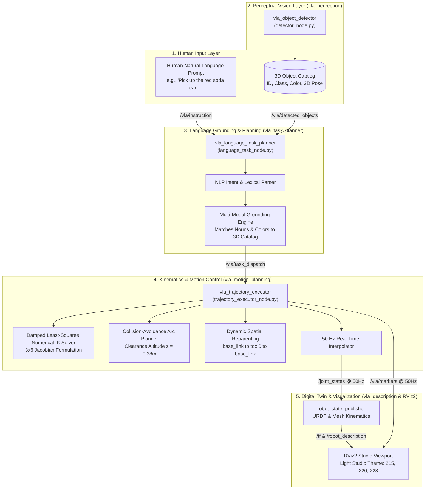

# Vision-Language-Action (VLA) Autonomous Robotic Manipulation

[](https://docs.ros.org/)
[](https://www.python.org/)
[](https://github.com/)
[](https://opensource.org/licenses/MIT)

An end-to-end **Vision-Language-Action (VLA)** robotic manipulation system in ROS 2. The pipeline accepts unstructured natural language commands (e.g., *"Pick up the red soda can, avoid the laser barrier, and deliver it to Docking Bay 1"*), grounds them against a real-time 3D perception stream, plans collision-aware 3D trajectory arcs over obstacles, solves 6-DOF numerical inverse kinematics, and executes manipulation tasks with dynamic spatial reparenting.

---

## Architecture Overview



---

## Key Capabilities

1. **Multi-Modal Symbol Grounding**:
   - Bridges human vocabulary (nouns and colors like *"red soda can"*, *"coke"*, *"blue mug"*, *"coffee"*, *"green flask"*) to physical 3D spatial frames discovered by the perception catalog.
   - Fallback mechanisms for safety rejection when target items are absent or instructions are malformed.

2. **Damped Least-Squares (DLS) Inverse Kinematics**:
   - Computes numerical inverse kinematics for the 6-DOF SESAC manipulator with tool offsets.
   - Formulates a $3 \times 6$ numerical Jacobian with Levenberg-Marquardt damping ($\lambda = 0.02$) to guarantee smooth inversion without singularity instability or axis flipping:
     $$\Delta \mathbf{q} = \mathbf{J}^{\top} \left( \mathbf{J} \mathbf{J}^{\top} + \lambda^2 \mathbf{I}_{3 \times 3} \right)^{-1} \mathbf{e}$$
   - Converges to $< 0.0007\,\text{m}$ Cartesian positioning error in under 50 iterations.

3. **Collision-Aware Trajectory Arc Synthesis**:
   - Evaluates obstacle bounding geometry (central laser security gate, height $0.20\,\text{m}$).
   - Automatically computes a 7-stage spatial waypoint trajectory elevating the object through a high-altitude transit arc ($z = 0.38\,\text{m}$) before descending onto the target docking platform.

4. **Dynamic Spatial Reparenting (TF2 Ownership)**:
   - Solves the multi-parent conflict in ROS 2 transform graphs:
     - **On Table**: Object frame is a child of `base_link`.
     - **During Grasp**: Controller assumes ownership and reparents the object to the gripper flange (`tool0`) at $50\,\text{Hz}$, moving synchronously with the fingertips.
     - **On Release**: Controller transfers ownership back to `base_link`, locked at the center bullseye of Docking Bay 01.

5. **High-Fidelity Studio Digital Twin (RViz2)**:
   - **Environment**: Dark titanium slate workbench ($1.15\,\text{m} \times 1.35\,\text{m}$) on brushed aluminum pillars, anti-static ESD rubber mat with glowing neon cyan border, and floor hazard safety demarcations.
   - **Realistic 3D Objects**: Cylindrical Red Soda Can (with silver pull-tab lid and base rim), Blue Ceramic Mug (with coffee and handle), and Green Specimen Flask (with gold screw cap).
   - **Autonomous Docking Station**: Multi-tiered alloy landing deck with concentric cyan, white, and golden bullseye rings with 4 LED guide pins.
   - **Trajectory Visualizer**: Real-time electric cyan 3D ribbon tracing the exact smooth transit curve through the air.
   - **Studio Lighting**: Default Soft Studio Grey background (`RGB: 215; 220; 228`) for maximum contrast and zero eye strain.

---

## Repository Structure

```
vla-robotic-manipulation/
├── README.md
├── .gitignore
├── LICENSE
└── src/
    ├── sesac_robot/              # 6-DOF manipulator description, URDF xacro & 3D visual/collision meshes
    ├── vla_bringup/              # Launch orchestration (vla_system.launch.py)
    ├── vla_description/          # Studio workspace RViz configuration (vla_scene.rviz)
    ├── vla_motion_planning/      # DLS numerical IK solver, 50 Hz trajectory executor & TF reparenting
    ├── vla_perception/           # 3D object detection simulator & perception stream catalog
    └── vla_task_planner/         # NLP intent parser & multi-modal symbol grounding engine
```

---

## Installation & Build

### Prerequisites
- **Ubuntu 22.04 / 24.04** or **Debian Testing (Trixie)** on x86_64 or Apple Silicon (UTM / QEMU aarch64).
- **ROS 2**: Compatible with `Humble`, `Iron`, `Jazzy`, or `Lyrical`.

### Build Workspace
```bash
# Clone into your workspace
mkdir -p ~/vla_ws/src
cd ~/vla_ws/src
git clone <your-repo-url> .

# Build with colcon
cd ~/vla_ws
colcon build --symlink-install

# Source environment
source install/setup.bash
```

---

## Quickstart

### 1. Launch the Digital Twin & VLA Nodes
```bash
ros2 launch vla_bringup vla_system.launch.py
```
This starts:
- `robot_state_publisher` loading the URDF robot meshes.
- RViz2 with the clean studio workbench, 3D objects, laser barrier, and docking bay.
- `vla_object_detector` streaming perception data.
- `vla_language_task_planner` awaiting natural language instructions.
- `vla_trajectory_executor` running kinematics and TF2 reparenting at $50\,\text{Hz}$.

---

### 2. Dispatch Natural Language Instructions
Open a second terminal window, source the workspace, and send commands:

#### Test 1: Full Collision-Aware Pick-and-Place (Red Can)
```bash
ros2 topic pub --once /vla/instruction std_msgs/msg/String \
  "data: 'Pick up the red soda can, avoid the laser barrier, and deliver it to Docking Bay 1'"
```
* **Robot Action**: Swings over to the red can, descends, closes gripper, lifts, arcs high ($z = 0.38\,\text{m}$) over the laser barrier, descends onto the docking bay bullseye, releases the can, and returns home.

#### Test 2: Low-Altitude Direct Transfer (Blue Mug)
```bash
ros2 topic pub --once /vla/instruction std_msgs/msg/String \
  "data: 'Take the blue coffee mug and place it on Docking Bay 1'"
```
* **Robot Action**: Transits directly at hover altitude ($z = 0.16\,\text{m}$) without climbing over obstacle height.

#### Test 3: Workspace Reachability Limits (Green Flask)
```bash
ros2 topic pub --once /vla/instruction std_msgs/msg/String \
  "data: 'Transfer the green specimen flask over the laser barrier to the dock'"
```
* **Robot Action**: Reaches the far lateral target ($y = -0.35\,\text{m}$), solves the kinematics cleanly, clears the obstacle, and docks the payload.

#### Test 4: Safety Rejection (Non-Existent Target)
```bash
ros2 topic pub --once /vla/instruction std_msgs/msg/String \
  "data: 'Pick up the purple bottle and put it on the dock'"
```
* **Robot Action**: Safely rejected with log `[ERROR] Perception cannot find any "purple" object in the scene!`. The robot remains stationary.

---

## Background Color Presets in RViz

To switch studio lighting themes in RViz:
1. In the left panel, expand **Global Options**.
2. Click **Background Color** and enter:
   - **Clean Studio Grey (Default)**: `215; 220; 228`
   - **Warm Lab White**: `245; 247; 250`
   - **Engineering Slate Blue**: `65; 72; 82`

---

## License
Distributed under the **MIT License**. See `LICENSE` for details.
